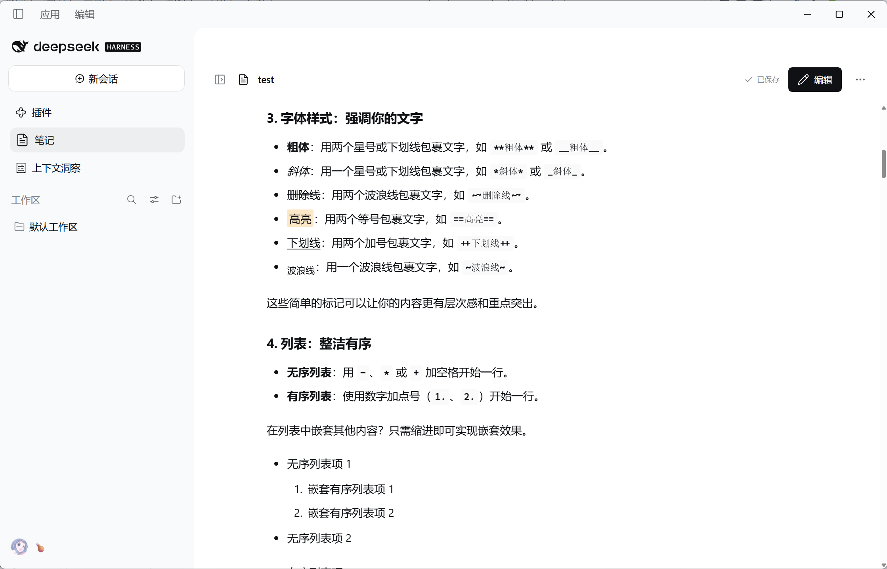
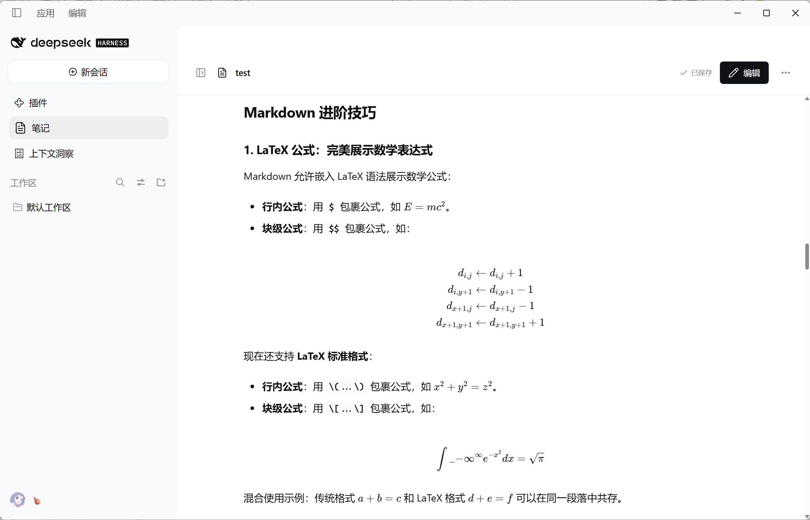
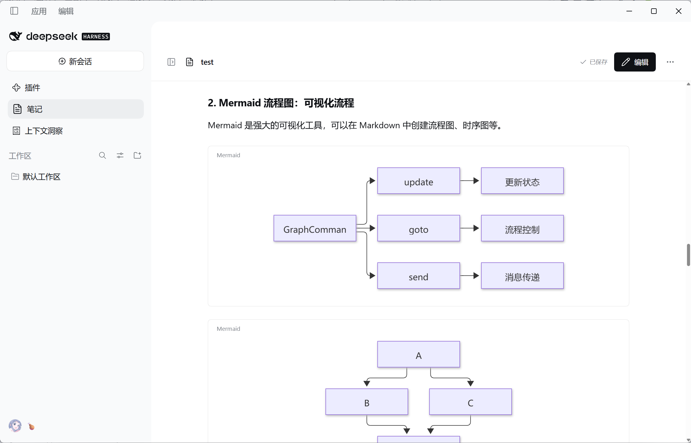
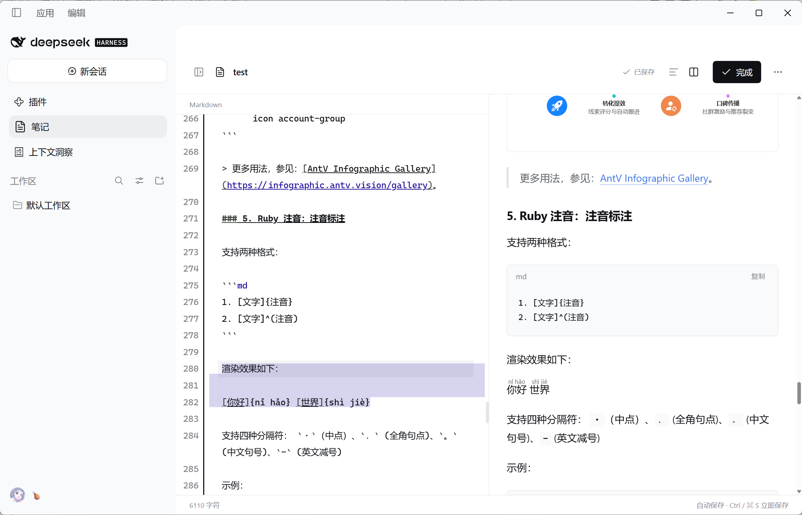

# DSH Markdown Notes

在 **DeepSeek Harness 桌面端**里，留一处安静记录的地方。

一个独立的 Markdown 笔记插件：从左侧进入，默认阅读，随时编辑，保存为电脑上的普通 `.md` 文件。所有工作区共用笔记目录，无需调用模型或连接云端笔记服务。

[下载安装包](https://github.com/Wanyi424/dsh-markdown-notes/releases/latest) · [使用说明](#使用) · [开发](#开发) · [反馈问题](https://github.com/Wanyi424/dsh-markdown-notes/issues)


> 社区插件，与 DeepSeek 官方无隶属关系。目前面向 **Windows 桌面版 DSH 0.2 系列**开发（`engines.dsh` 声明 `^0.2.0-rc.2`），在 0.2.0-rc.2 上验证过；其他版本尚未验证。

## 功能

- **阅读与编辑**：默认展示排版后的文章；顶栏「阅读 / 编辑 / 并排」一键切换（`Ctrl+E` 在阅读与上次的编辑布局之间切换），并排时双向同步滚动。
- **文档大纲**：阅读和并排时都可用，点击跳转，滚动时高亮当前章节。宽屏时常驻在正文右侧；窗口较窄或并排时变成右边缘的刻度条，悬停即可展开完整大纲。
- **预览主题**：「默认 / 书刊 / 公众号」三套排版，顶栏「主题」切换并记住选择，只影响预览，不改动文件。
- **文档管理**：多级文件夹树、标题即时筛选、新建、重命名、移动、删除、另存为副本；文件夹和笔记支持悬停操作与右键菜单，把笔记拖到文件夹上即可移动。
- **自动保存**：停止输入约 450 ms 后保存；离开编辑区、切换文档或点击「完成」时保存，也支持 `Ctrl+S` / `⌘S`。
- **丰富的 Markdown**：代码高亮、表格、任务列表、脚注、数学公式、Mermaid、信息图、注音和提示框。
- **拖拽导入**：把 `.md` / `.markdown` 文件拖入页面，复制导入并打开；拖到某个文件夹上时导入到该文件夹。保留原文件，同名文档自动改名。
- **目录迁移**：在界面中更换保存目录，自动搬迁笔记，迁移成功后删除空的旧文件夹。
- **资源管理器**：从侧栏「…」菜单直接打开当前笔记目录。
- **按需加载**：未打开笔记时仅加载轻量入口，编辑器和图表库在使用时加载。

不注册 Agent 工具，不读取聊天记录，不请求模型。没有同步、附件管理或版本历史。

## 更多预览

以下截图来自实际 DSH 桌面窗口，截图中的 DSH 导航栏属于宿主应用。截图为 0.3.x 版界面，0.4.x / 0.5.x 的界面截图待在真实 DSH 中更新。

<details>
<summary><strong>文本样式与嵌套列表</strong></summary>



</details>

<details>
<summary><strong>LaTeX 数学公式</strong></summary>



</details>

<details>
<summary><strong>Mermaid 流程图</strong></summary>



</details>

<details>
<summary><strong>源码编辑与并排预览</strong></summary>



</details>

## 安装

1. 从 [Releases](https://github.com/Wanyi424/dsh-markdown-notes/releases/latest) 下载 `dsh-markdown-notes-0.5.3.tgz`，**无需解压**。
2. 打开 DSH **主界面左侧「插件」**，点击右上角「添加插件」。入口不在设置中的「内置插件」列表里。
3. 粘贴下载包的完整本地路径，例如：

   ```text
   D:\Plugins\dsh-markdown-notes-0.5.3.tgz
   ```

4. 按提示安装、启用；如果提示需要重启，重启 DSH。
5. 从左侧「笔记」进入。

Release 安装包已包含构建产物，不需要单独安装 Node.js、React 或构建工具。GitHub 自动生成的 **Source code ZIP** 是源码，不是可直接导入的插件安装包。

### 升级

关闭正在编辑的笔记并确认显示「已保存」，然后通过 DSH 插件页面卸载旧版、安装新版并重启。笔记与保存位置配置独立于安装包，卸载插件不会删除它们。

安装包通过 `engines.dsh` 声明兼容 DSH 0.2 系列（`^0.2.0-rc.2`）。如果更新的 DSH（例如 0.3）拒绝安装，请先核对兼容性，不要直接忽略版本检查。

## 使用

### 阅读、编辑和管理文档

- 侧栏顶部「＋」在当前选中的文件夹中新建笔记并进入编辑；悬停时的提示会显示目标位置。侧栏「…」管理整个笔记库：新建文件夹、导入、刷新、打开文件夹、保存位置。
- 在侧栏的筛选框中输入，按标题即时过滤（也匹配所在文件夹）；`Enter` 打开第一条，`Esc` 清除。
- 单击笔记打开阅读。顶栏的「阅读 / 编辑 / 并排」切换模式，`Ctrl+E` 在阅读和上次的编辑布局之间切换；保存状态以小圆点和文字显示。编辑区为居中的写作栏，标题、强调、链接和代码分层着色。
- 文档至少有两个标题时，顶栏出现「大纲」：
  - 正文区宽度不低于 960 px 的阅读模式下，大纲常驻在正文右侧，「大纲」按钮用于隐藏或显示；
  - 窗口较窄或处于并排模式时，预览右边缘显示一列刻度，每个标题一条，当前章节为强调色。鼠标悬停在刻度上会展开完整大纲，点击刻度直接跳到该章节；点「大纲」按钮则把大纲固定展开，选择章节或按 `Esc` 后收起。键盘和触屏也走这个入口。
- 顶栏「主题」切换预览排版，选择保存在本机：
  - **默认**：清爽的界面风格，提示块带图标，引用、分割线和高亮经过精修；
  - **书刊**：米色纸张底、衬线正文与标题、居中标题、段首缩进、首字下沉、楷体引用、三线表，图片下方显示说明；
  - **公众号**：居中标题、主题色色块的二级标题、两端对齐、窗口式代码块，图片下方显示说明，便于预览文章的发布效果。样式不会随复制带入公众号编辑器。
  主题只改变预览显示，不修改 Markdown 文件。书刊主题优先使用系统中的 Noto Serif SC / 思源宋体和楷体，没有安装时退回界面字体。
- 图片的替代文字（``）在书刊和公众号主题中显示为图片说明；文件名或「图片」「截图」这类占位文字不会显示。
- 并排模式下，滚动任意一侧会同步另一侧。通过源码行与正文块的位置对应，适应代码、公式和图片造成的高度差；图片和图表加载后保留当前阅读位置。
- 点击顶部的笔记名称可以改名，点击前面的文件夹路径可在侧栏中定位。顶栏「…」只管当前笔记：重命名、移动到…、另存为副本、删除。
- 文件夹展开和收起时，子项平滑展开或收拢，箭头同步旋转。左侧栏收起和展开时，宽屏下栏宽平滑过渡；窄窗口下抽屉从左侧滑入、点空白处滑出。菜单和对话框（按 `Esc`、点空白处或 ×）关闭时也会淡出。
- 文件夹和笔记在悬停时显示快捷按钮，右键弹出同样的菜单；侧栏和对话框中的操作结果以顶部提示显示，几秒后自动消失。
- 窗口较窄时，侧栏变为从左侧滑出的抽屉。
- 删除需要确认，确认后直接删除磁盘文件，不进入回收站。
- 文件被其他编辑器修改时，插件会提示冲突并保留草稿，可使用「草稿另存为」。

### 保存位置与自动迁移

默认位置由 DSH 官方 `@deepseek-ai/dsh-home-paths` 路径库解析，位于 DSH 数据根目录下。例如未设置 `DSH_HOME` 时：

```text
%USERPROFILE%\.dsh\plugin-data\dsh-markdown-notes\notes
```

在侧栏「…」→「保存位置…」中选择文件夹或输入绝对路径，点击「迁移并使用」：

1. 保存当前草稿，检查新旧目录和同名冲突。
2. 保持子目录结构，复制普通 `.md` 笔记与初始化标记，并重建空文件夹。
3. 保存新路径，再清理已成功迁移的旧文件。
4. 清理迁移后的空文件夹；旧目录中还有无关文件或迁移期间被外部修改的文件时，保留并提示。

迁移不会覆盖目标目录中的同名文档。复制或配置保存失败时，原文件保留。新旧目录不能互为父子目录，也不能是磁盘根目录、用户主目录或目录链接。

文件夹创建、重命名、移动笔记和迁移的详细说明见 [多级文件夹](docs/folders.md)。

新路径保存在 `$DSH_HOME/plugin-data/dsh-markdown-notes/settings.json`（默认 `%USERPROFILE%\.dsh\plugin-data\dsh-markdown-notes\settings.json`），重启后继续生效。插件的 `directory` 配置项仅作为首次使用时的初始目录；之后请通过界面迁移。设置文件留在插件数据目录，迁移只移动笔记内容。

`plugin-data/dsh-markdown-notes` 是本插件在 DSH 数据根目录中使用的独立子目录，普通 Markdown 文件仍由插件读写，不转为 DSH 的 KV 存储格式。所有工作区共用这套笔记。当前仍在开发阶段，本版本不读取或迁移旧的 `.dsh-markdown-notes` 设置及 `Documents/DSH Notes` 数据，也不包含旧版兼容逻辑。

### 导入 Markdown

将 UTF-8 编码的 `.md` / `.markdown` 文件拖到笔记页面，或选择侧栏「…」→「导入 Markdown…」。拖到侧栏中的某个文件夹上时导入该文件夹，否则导入当前选中的文件夹；也可以右键文件夹选择「导入到此文件夹…」。文件会复制到笔记目录，原文件不变；同名文档会添加 `(2)` 等后缀。

每批最多 **20 篇**、合计 **20 MB**，单篇最大 **2 MB**。直接放入目录的 Markdown 文件，可通过侧栏「…」→「刷新列表」加载。

### 默认示例

首次使用会创建 `Markdown 内容示例.md`，展示常见及扩展语法。同名文件已存在时不覆盖；示例可自由编辑、改名或删除。删除后不会反复生成。

示例改编自 [Doocs Markdown 编辑器](https://github.com/doocs/md)的示例文档，已移除结语后的推荐阅读和二维码。原文中关于微信公众号菜单、公式编辑器等其他产品的说明仅作为文章保留，不代表本插件提供对应功能。来源与许可见 [第三方说明](THIRD_PARTY.md)。

“链接与图片”示例指向 [Wanyi424 的 GitHub 主页](https://github.com/Wanyi424)，图片使用本项目生成的 [DSH Markdown Notes 宣传图](docs/images/plugin-banner.png)。升级不会覆盖已经创建或修改过的笔记，可从 `src/assets/sample.md` 重新导入最新示例。

### 打开资源管理器

侧栏「…」→「在资源管理器打开」读取宿主端当前笔记目录，并调用 DSH 原生的应用打开接口，不再自行启动隐藏的 `explorer.exe` 进程。原生接口返回失败时会显示错误。

笔记请求会核对界面与宿主的版本。如果提示“前后端版本不一致”，请核对安装包和插件列表，完整退出并重新启动 DSH；若仍失败，反馈提示中的两个版本号和具体错误。

## Markdown 支持范围

| 内容 | 支持情况 |
| --- | --- |
| 标题、段落、强调、删除线、分隔线 | 支持一至六级标题 |
| 列表与引用 | 有序、无序、嵌套列表、任务列表、多层引用；任务状态通过源码修改 |
| 链接、图片、表格、脚注 | 支持网络图片、文档内脚注跳转 |
| 代码 | 常用语言高亮、复制；未知语言保留原文 |
| 数学公式 | KaTeX：`$…$`、`$$…$$`、`\(…\)`、`\[…\]` |
| Mermaid | 本地渲染流程图、饼图等图表 |
| AntV Infographic | 本地模板渲染，默认示例的四个图标随包提供 |
| PlantUML | 展示源码，不发送至外部渲染服务 |
| 行内扩展 | `==高亮==`、`++下划线++`、`~下标~`、`^上标^`、Ruby 注音 |
| 提示框与学术环境 | `> [!TIP]` 等警告块，以及 `::: tip`、`::: theorem` 等容器 |
| 目录 | 单独一行的 `[TOC]` 生成二级及以下标题目录 |
| HTML | 保留经过清理的展示标签，不执行脚本和事件处理器 |

公式字体、图表引擎和默认信息图图标随插件提供。Markdown 中的网络图片仍从原地址加载；自定义信息图中未随包提供的图标会省略，不联网检索。没有图片上传、本地附件解析或微信公众号专用图片滑动组件。

## 性能与边界

- 启动入口约 **23 KB**，页面（约 96 KB，含三套预览主题的样式）、编辑器、预览、Mermaid 和信息图库通过 DSH 原生加载器分别加载。
- 编辑时文件树不随按键重绘，收起的文件夹不构建子项；大纲高亮由 IntersectionObserver 驱动，不监听滚动；切换预览主题只改样式，不重新渲染文档。
- 动效以 transform / opacity 为主；文件夹折叠和侧栏收放会改变尺寸，只作用于侧栏和栏宽本身。缓动曲线把位移均匀分布在整个时长里，避免前几帧就完成。系统开启「减少动态效果」时，动效自动关闭。
- 图表接近可视区域时才绘制；并排预览等待输入停顿 **300 ms** 后更新。
- Mermaid 缓存最多 12 项、约 100 万字符；不启动后台轮询或目录监听。
- 超过 **12 万字符**的文档暂停自动预览，可手动加载；超过 **8,000 字符或 180 行**的图表需手动绘制，超过 **32,000 字符**仅展示源码。
- 文件操作采用异步 I/O；迁移只串行化本插件的操作。

插件仍与 DSH 共享界面线程，首次加载和复杂图表可能产生短暂长任务，已经加载的库也会占用内存。因此不承诺任意文档都绝对零卡顿。强制结束进程或断电时，尚未写入的草稿也不能保证恢复。

## 开发

需要 **Node.js 22+** 和 npm。

```bash
git clone https://github.com/Wanyi424/dsh-markdown-notes.git
cd dsh-markdown-notes
npm ci --ignore-scripts
npm run build
npm run typecheck
npm test
npm pack --pack-destination dist
```

`npm run build` 会先生成内置示例、离线图标和 KaTeX 字体样式。生成文件不提交到 Git。需要单独生成时运行 `npm run generate`。

构建完成后，可在 DSH「添加插件」中输入项目的绝对路径进行本地安装。修改后重新构建并重启 DSH。

### 浏览器检查

```bash
npx playwright install chromium
node scripts/browser-check.mjs
node scripts/folders-browser-check.mjs
```

检查脚本使用构建后的真实插件代码、文件 API 和独立临时目录，不连接 DSH 账号或读取个人笔记。页面与接口通过请求拦截提供，不占用本机端口。覆盖阅读、大纲（常驻、刻度悬停展开、固定展开与 `Esc`、无横向滚动、切换笔记后保留）、侧栏 / 抽屉 / 菜单 / 对话框的退场动画、三套预览主题、筛选、右键菜单、编辑与 `Ctrl+E`、保存、导入、迁移、按需加载、明暗主题及窄窗口；文件夹检查另覆盖选中高亮、折叠动画、拖拽移动、移动对话框和空文件夹删除。结束后关闭浏览器并清理临时数据，结果写入 `artifacts/qa` 与 `artifacts/qa-folders`。

Explorer 原生接口在测试中使用替身，核对接口、目标目录与错误处理。隔离浏览器测试不能替代 DSH 原生加载器、目录选择器和 Explorer 窗口的宿主验收。滚动同步已检查两个方向、文档首尾、异步图表加载以及停止滚动后的稳定性。

### 主要文件

| 文件 | 职责 |
| --- | --- |
| `src/client.tsx` / `src/page.tsx` | 轻量入口、笔记页面与交互 |
| `src/folder-tree.tsx` / `src/outline.tsx` | 文件夹树（悬停操作、右键、拖拽、键盘导航、折叠动画）与文档大纲（常驻列表、刻度条） |
| `src/ui.tsx` | 菜单、对话框、分段切换与提示等通用界面组件 |
| `src/editor.tsx` / `src/preview.tsx` | 编辑器与按需预览 |
| `src/markdown.ts` | Markdown 解析及扩展语法 |
| `src/storage.ts` | 文件读写、导入、迁移 |
| `src/settings.ts` / `src/api.ts` | 保存位置配置、版本核对与 DSH 原生目录入口 |
| `src/scroll-sync.ts` | 基于源码行的双向滚动同步 |
| `scripts/build.mjs` | DSH 分块构建与依赖许可汇总 |
| `scripts/browser-harness.mjs` | 浏览器检查的共用载体（请求拦截，无需端口） |
| `tests/` | 保存顺序、迁移、导入、渲染等测试 |

欢迎通过 [Issues](https://github.com/Wanyi424/dsh-markdown-notes/issues) 反馈问题。请附上 DSH 版本、插件版本、复现步骤和经过脱敏的截图或最小 Markdown 示例。

## 许可证与致谢

本项目代码采用 [MIT License](LICENSE)。第三方库、示例内容与相关品牌遵循各自的许可，详见 [THIRD_PARTY.md](THIRD_PARTY.md)。

感谢 DeepSeek Harness、CodeMirror、markdown-it、KaTeX、Mermaid、AntV Infographic、DOMPurify、Highlight.js、Lucide、Material Design Icons 与 Doocs。
